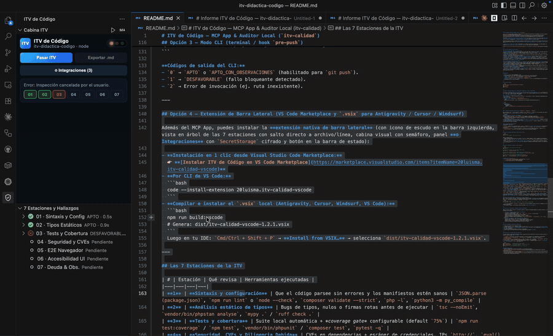
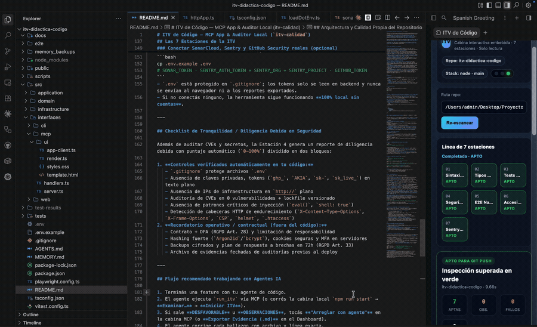

# ITV de Código — VS Code Extension, MCP App & Local Code Quality Gate (`itv-calidad`)

🌐 **Language / Idioma:** [🇪🇸 Español](README.md) | **🇬🇧 English (current)**

[](https://github.com/20Luisma/itv-calidad/actions/workflows/ci.yml)
[](https://marketplace.visualstudio.com/items?itemName=20luisma.itv-calidad-vscode)

**100% local, open-source, zero-mandatory-accounts** code quality and security gate (**VS Code / Open VSX Sidebar Extension + Interactive MCP App + Stdio MCP Server + Live SSE Web Dashboard + CLI**) that audits any local repository (**PHP, Node.js/TypeScript, or Python**) **before `git push`** across **7 real quality, security, and observability stations**.

Built for developers and teams coding with AI agents: instead of an opaque cloud pipeline failure, it shows step by step **what each station checks, the exact command executed, why it matters, and how to fix each finding**.

> **Read-only & 100% local:** runs entirely on your machine with no mandatory API keys, no paid tokens, no telemetry, and **never modifies or deletes any file** in the inspected repository.



### How do you want to use it? (Pick 1 option — same 7-station engine)

| If you want to… | Use this | Get started in 10 seconds |
|---|---|---|
| **Install in 1 click inside your IDE** *(recommended)* | **VS Code / Open VSX Extension** | [Install from VS Code Marketplace](https://marketplace.visualstudio.com/items?itemName=20luisma.itv-calidad-vscode) |
| **Have your AI agent run it before pushing** | **MCP App + MCP Server** | Jump to [Option 1 — MCP](#option-1--interactive-mcp-app--mcp-server-antigravity-cursor-claude-code) |
| **Watch the cockpit in slow motion in your browser** | **Local SSE Web Dashboard** | `npm run start` → `http://127.0.0.1:4173` |
| **Run from terminal or a `pre-push` hook** | **CLI** | `npm run itv -- /path/to/your/repo` |

---

## What it actually does (and what it does NOT do)

### What it DOES (100% real, zero simulations)
- **Runs real tools** against your local repository (PHP, Node.js/TypeScript, or Python, including mixed or manifest-free repos) preserving real exit codes (**zero false greens**).
- **Blocks `git push` (`exit code != 0`)** whenever any mandatory station fails (syntax, static types, tests/coverage, CVEs/secrets, E2E, or critical accessibility).
- **Honestly marks inapplicable stations as `OMITIDA` (Skipped)** (e.g., if Playwright is not installed), explaining how to add them if you want.
- **Generates a Security Due-Diligence Checklist** (based on OWASP ASVS Level 1 and GDPR Art. 32 technical controls) with timestamped **Markdown (`.md`) and JSON (`.json`) evidence export**.
- **Embedded interactive cockpit inside your IDE (MCP App & VS Code Extension):** dark-mode traffic light, animated station scan, jump-to-file/line findings tree, encrypted `SecretStorage` integrations panel, and one-click *"Fix with agent"* prompt.

### What it does NOT do (full transparency)
- **Complements GitHub Actions / CI — does not replace it:** acts as a **fast local pre-push barrier** (preventing leaked secrets, type errors, or CVEs from reaching Git), while cloud CI + Branch Protection remain recommended for teams and production deployments.
- **Does not replace** a professional penetration test, enterprise SAST (SonarQube / CodeQL / Semgrep), or formal security audit for critical/regulated systems.
- **Not legal advice:** the operational/contractual checklist block (DPA, encrypted backups, 72h breach response) is a technical best-practice guide based on OWASP/GDPR.
- **Run only on trusted repositories:** although the tool is read-only and executes commands via `spawn` with `shell: false`, Stations 3 and 5 execute the target repository's own test suites (`npm test`, `phpunit`, `pytest`, Playwright). Do not run it on untrusted third-party repositories outside an isolated container or VM.
- **Never installs or mutates dependencies in the target repo:** uses binaries already available on your machine or inside the target project's `node_modules`/`vendor`.
- **Cross-platform (macOS, Windows, Linux):** native folder picker in all 3 OSes (Finder on macOS, PowerShell dialog on Windows, `zenity`/`kdialog` on Linux), plus manual path input and CLI.

---

## Requirements

- **Node.js `>= 20`** (LTS recommended) and `npm`.
- Only the local tools for the stack you want to inspect:
  - **Node / TypeScript:** `npm`, project `tsc`, `vitest`/`jest`.
  - **PHP:** `php`, `composer`, `vendor/bin/phpstan`, `vendor/bin/phpunit`.
  - **Python:** `python3`, `pytest`, `mypy` or `ruff`, `pip-audit`.
  - **Optional (live WCAG 2.1 AA on a local URL):** `npm install -g pa11y` (auto-detects local Chrome/Chromium/Brave on macOS/Windows/Linux).

---

## Quick Install

```bash
git clone https://github.com/20Luisma/itv-calidad.git
cd itv-calidad
npm install
npm run build
```

---

## Option 1 — Interactive MCP App & MCP Server (Antigravity, Cursor, Claude Code)

`itv-calidad` ships an official **Stdio MCP Server** with an **embedded MCP App UI** (`ui://itv-calidad/app.html` built on `@modelcontextprotocol/ext-apps`). In compatible hosts (Antigravity, Claude Desktop, VS Code), running `run_itv` renders the interactive cockpit directly inside chat and the side pane.



### 1. Register the MCP server in your IDE / Agent
- **Antigravity:** `~/.gemini/antigravity/mcp_config.json` *(restart Antigravity completely after editing to load the MCP App)*
- **Cursor:** `.cursor/mcp.json` or `~/.cursor/mcp.json`
- **Claude Desktop / Claude Code:** `claude_desktop_config.json` or:
  ```bash
  claude mcp add itv-calidad -- node /absolute/path/to/itv-calidad/dist/interfaces/mcp/server.js
  ```

```json
{
  "mcpServers": {
    "itv-calidad": {
      "command": "node",
      "args": ["/absolute/path/to/itv-calidad/dist/interfaces/mcp/server.js"],
      "env": {
        "SONAR_TOKEN": "(optional)",
        "SENTRY_AUTH_TOKEN": "(optional)",
        "SENTRY_ORG": "(optional)",
        "SENTRY_PROJECT": "(optional)",
        "GITHUB_TOKEN": "(optional)"
      }
    }
  }
}
```
*(The `"env"` block is 100% optional: omit it to run completely offline with zero accounts. A local `.env` file is also supported.)*

### 2. Automatic pre-push rule for `GEMINI.md` / `AGENTS.md` / `CLAUDE.md`

Paste this rule into your global `~/.gemini/GEMINI.md` or project `AGENTS.md` / `CLAUDE.md` so your AI agent runs the gate **automatically before every `git push`, tag, or deploy**:

```markdown
## Automatic ITV Quality Gate (Pre-Push / Pre-Deploy)
Before any `git push` to `main`, stable tag creation, or production deployment:
1. Call the MCP tool `itv-calidad` → `run_itv` passing the absolute project path (`repoPath`).
   *(CLI fallback only if MCP is unavailable: `cd /absolute/path/to/itv-calidad && npm run itv -- <repo_path> --fast`)*.
2. **DESFAVORABLE (Stations 1–4: syntax, types, tests/coverage, security/secrets/CVEs):** BLOCKS push/deploy. Fix all findings and re-verify before proceeding.
3. **OBSERVACIONES (Stations 5–7: E2E, WCAG, code health/observability):** report a 1-line summary and ask whether to polish before closing the release.
```

### 3. Exposed MCP Tools
| Tool | Description |
|---|---|
| `run_itv` | Runs all 7 stations on `repoPath`, renders the embedded MCP App cockpit (`ui://itv-calidad/app.html`), and returns structured JSON or Markdown (`minCoverage` and `targetUrl` optional). |
| `get_security_checklist` | Runs Station 4 and returns the OWASP ASVS Level 1 / GDPR Art. 32 due-diligence checklist. |
| `list_itv_stations` | Lists all 7 stations and their technical scope without executing commands. |

---

## Option 2 — Local Web Dashboard (Slow-Motion SSE)

```bash
npm run start
# Open in browser: http://127.0.0.1:4173
```

---

## Option 3 — CLI Mode (Terminal / `pre-push` Hook)

```bash
npm run itv -- .
npm run itv -- /path/to/your/project --fast
npm run itv -- /path/to/your/project --min-coverage 80 --url http://127.0.0.1:3000
npm run itv -- /path/to/your/project --markdown > itv-evidence.md
npm run itv -- /path/to/your/project --json > itv-evidence.json
```

**CLI exit codes:**
- `0` → `APTO` or `APTO_CON_OBSERVACIONES` (safe to push).
- `1` → `DESFAVORABLE` (blocking failure detected).
- `2` → Invocation error (e.g. invalid path).

---

## Option 4 — Sidebar IDE Extension (VS Code Marketplace & `.vsix` for Antigravity / Cursor / Windsurf)

Install the native sidebar extension with a dedicated shield icon in the Activity Bar, live traffic light cockpit, clickable 7-station tree with jump-to-file/line, encrypted `SecretStorage` integrations panel, and status bar badge:

- **1-click install from Visual Studio Code Marketplace:**
  👉 **[Install ITV de Código on VS Code Marketplace](https://marketplace.visualstudio.com/items?itemName=20luisma.itv-calidad-vscode)**
- **Via VS Code CLI:**
  ```bash
  code --install-extension 20luisma.itv-calidad-vscode
  ```
- **Build & install local `.vsix` (Antigravity, Cursor, Windsurf, VS Code):**
  ```bash
  npm run build:vscode
  # Outputs: dist/itv-calidad-vscode-1.3.0.vsix
  ```
  Then in your IDE: `Cmd/Ctrl + Shift + P` → **Install from VSIX…** → select `dist/itv-calidad-vscode-1.3.0.vsix`.

---

## The 7 Inspection Stations

| # | Station | What it checks | Tools executed |
|---|---|---|---|
| **1** | **Syntax & Config** | Code parses cleanly and project manifests are valid | `JSON.parse(package.json)`, `npm run lint` / `node --check`, `composer validate --strict`, `php -l`, `python3 -m py_compile` |
| **2** | **Static Type Analysis** | Type bugs, null safety, and broken contracts before runtime | `tsc --noEmit`, `vendor/bin/phpstan analyse`, `mypy .` / `ruff check .` |
| **3** | **Tests & Coverage** | Automated local test suite + configurable coverage gate (default `75%`) | `npm run test:coverage` / `npm test`, `vendor/bin/phpunit`, `pytest -q` |
| **4** | **Security, CVEs & Due Diligence** | Dependency CVEs + hardcoded secret/IP/`eval()`/`shell: true` scanner + OWASP/GDPR checklist | `npm audit`, `composer audit`, `pip-audit` + built-in local scanners |
| **5** | **Browser E2E Tests** | Real user flows and negative paths if the repo includes E2E tests | `npm run test:e2e`, `npm run e2e`, or `playwright test` |
| **6** | **Accessibility & UI Quality** | WCAG 2.1 AA compliance on views and/or live local URL | `npm run test:a11y`, `pa11y --standard WCAG2AA <url>` + static scanner on `.html/.htm/.php/.jsx/.tsx/.vue` |
| **7** | **Code Health & Observability** | Local static analysis (large files, cyclomatic complexity, DRY duplicates, `debugger`/`var_dump`, Sentry/log checks) + **optional live SonarCloud, Sentry & GitHub Security connectors** | Local scanner (0 accounts) + optional API integration via `.env` / `SecretStorage` |

---

## Architecture & Self-Inspection

This repository follows lightweight Clean Architecture, strict HTML/CSS/JS separation (strict CSP with no unsafe inline logic), and passes its own **7/7 APTO** inspection:

- `src/domain/` — Pure types, station catalog, and verdict calculation (zero Node/HTTP dependencies).
- `src/application/` — `DetectRepoStack`, `RunItvInspection`, and `ExportReportMarkdown`.
- `src/infrastructure/` — `SafeCommandExecutor` (`spawn` with `shell: false` and timeouts), `RepoFileWalker`, scanners, optional API clients, and the 7 stations.
- `src/interfaces/` — CLI (`cli/`), HTTP/SSE Web Dashboard (`web/` + `public/`), and Stdio MCP Server + MCP App (`mcp/`).
- `extensions/vscode-itv/` — Native VS Code / Open VSX sidebar extension reusing the same core engine.

```bash
npm run typecheck       # TypeScript strict (0 errors)
npm run test:coverage   # Isolated Vitest suite + coverage gate (>75%)
npm run audit:deps      # npm audit (0 CVEs)
npm run itv -- . --fast # 7/7 self-inspection
```
