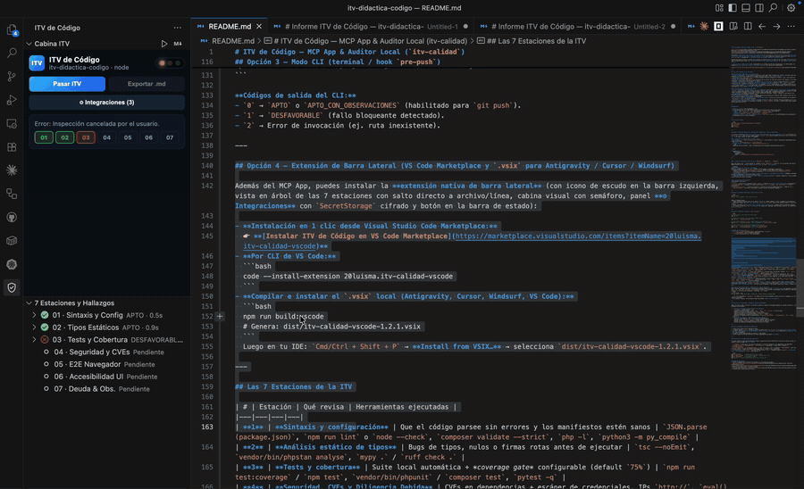
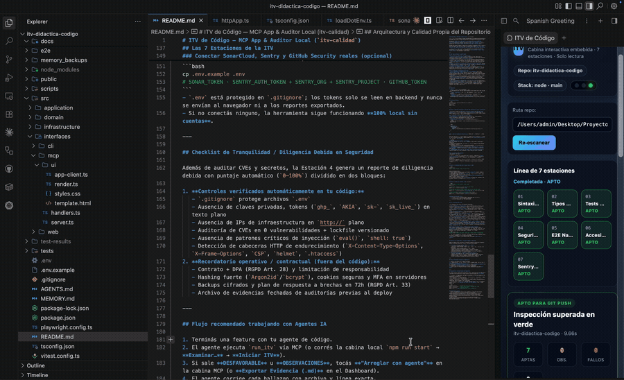

# ITV de Código — MCP App & Auditor Local (`itv-calidad`)

🌐 **Idioma / Language:** **🇪🇸 Español (actual)** | [🇬🇧 English](README.en.md)

[](https://github.com/20Luisma/itv-calidad/actions/workflows/ci.yml)
[](https://marketplace.visualstudio.com/items?itemName=20luisma.itv-calidad-vscode)

Herramienta **100% local, open-source y sin cuentas externas** (**Extensión de barra lateral VS Code/Open VSX + MCP App interactiva + Servidor MCP Stdio + Dashboard Web SSE + CLI**) que inspecciona cualquier repositorio local **antes de hacer `git push`** pasando por **7 estaciones reales de calidad, seguridad y observabilidad**.

Pensada para desarrolladores y equipos que programan con agentes de IA: en lugar de una "caja negra" que falla en la nube, te muestra paso a paso **qué revisa cada estación, qué comando exacto ejecuta, por qué importa y cómo corregir cada fallo**.

> **Solo lectura y 100% local:** corre íntegramente en tu máquina sin API keys obligatorias, sin tokens pagos, sin telemetría y **sin modificar ni borrar nunca ningún archivo** del repositorio inspeccionado.



### ¿Cómo prefieres usarla? (Elige 1 sola opción — mismo motor de 7 estaciones)

| Si quieres… | Usa esto | Empezar en 10 segundos |
|---|---|---|
| **Instalarla en 1 clic en tu IDE** *(recomendado)* | **Extensión VS Code / Open VSX** | [Instalar desde VS Code Marketplace](https://marketplace.visualstudio.com/items?itemName=20luisma.itv-calidad-vscode) |
| **Que tu agente IA la ejecute antes de pushear** | **MCP App + Servidor MCP** | Ir a [Opción 1 — MCP](#opción-1--mcp-app-interactiva-y-servidor-mcp-antigravity-cursor-claude-code) |
| **Ver la cabina en cámara lenta en el navegador** | **Dashboard Web SSE** | `npm run start` → `http://127.0.0.1:4173` |
| **Usarla en terminal o hook `pre-push`** | **CLI** | `npm run itv -- /ruta/a/tu/repo` |

---

## ¿Qué hace realmente (y qué NO hace)?

### Lo que SÍ hace (100% real, cero simulaciones)
- **Ejecuta herramientas reales** sobre tu repositorio local (PHP, Node.js/TypeScript o Python, incluidos repos mixtos o proyectos sin manifiesto) respetando sus códigos de salida reales (**cero falsos verdes**).
- **Bloquea el push (`exit code != 0`)** si falla cualquier estación obligatoria (sintaxis, tipos, tests/cobertura, CVEs/secretos, E2E o accesibilidad crítica).
- **Omite con honestidad (`OMITIDA`)** las estaciones que no aplican al stack del proyecto (por ejemplo, si no tiene Playwright), explicándote cómo agregarlas si quieres.
- **Genera un Checklist de Tranquilidad / Diligencia Debida en Seguridad** (basado en OWASP ASVS Nivel 1 y medidas técnicas del Art. 32 RGPD) y te permite **exportar la evidencia fechada en Markdown (`.md`) o JSON (`.json`)**.
- **Cabina visual embebida en tu IDE (MCP App):** al ejecutar `run_itv` en Antigravity, se renderiza directo en el chat (y en el panel lateral **`+`**) una cabina dark interactiva con semáforo LED, escaneo animado, detalle por estación, re-escaneo en 1 clic y botón **"Arreglar con agente"**.

### Lo que NO hace (transparencia ante todo)
- **Es un complemento a GitHub Actions / CI, no un reemplazo:** actúa como **primera barrera local rápida** antes del `git push` (evita subir secretos, errores de tipos o CVEs al repo), pero en equipos o despliegues a producción sigue siendo recomendable mantener CI en la nube (entorno limpio reproducible + *Branch Protection*).
- **No reemplaza** un pentest profesional, un SAST enterprise (SonarQube / CodeQL / Semgrep) ni una auditoría de seguridad formal para sistemas críticos o banca.
- **No constituye asesoramiento legal:** el bloque operativo/contractual del checklist (DPA, backups, plan 72h) es una guía técnica de buenas prácticas basada en OWASP/RGPD.
- **Ejecutar únicamente sobre repositorios propios o de confianza:** aunque la ITV es de solo lectura y usa `spawn` con `shell: false`, las Estaciones 3 y 5 ejecutan la suite de pruebas del proyecto inspeccionado (`npm test`, `phpunit`, `pytest`, Playwright). No la ejecutes sobre repositorios desconocidos sin aislamiento previo (contenedor/VM).
- **No instala ni modifica dependencias en el repo inspeccionado:** utiliza los binarios disponibles en tu máquina o en `node_modules`/`vendor` del propio proyecto.
- **Compatible con macOS, Windows y Linux:** el botón **Examinar…** abre el selector nativo de carpetas en los 3 sistemas (Finder en macOS, Explorador vía PowerShell en Windows y `zenity`/`kdialog` en Linux), y también puedes pegar cualquier ruta a mano o usar el CLI.

---

## Requisitos

- **Node.js `>= 20`** (LTS recomendado) y `npm`.
- Las herramientas del stack que quieras auditar en tu máquina local (solo las que uses):
  - **Node / TypeScript:** `npm`, `tsc` (del proyecto), `vitest`/`jest` (del proyecto).
  - **PHP:** `php`, `composer`, `vendor/bin/phpstan`, `vendor/bin/phpunit`.
  - **Python:** `python3`, `pytest`, `mypy` o `ruff`, `pip-audit`.
  - **Opcional (WCAG 2.1 AA en vivo sobre URL local):** `npm install -g pa11y` (en macOS/Windows/Linux autodetecta Chrome/Chromium/Brave si ya lo tienes instalado).

---

## Instalación Rápida

```bash
git clone https://github.com/20Luisma/itv-calidad.git
cd itv-calidad
npm install
npm run build
```

---

## Opción 1 — MCP App Interactiva y Servidor MCP (Antigravity, Cursor, Claude Code)

`itv-calidad` incluye un **MCP Server oficial por Stdio** con **MCP App visual embebida** (`ui://itv-calidad/app.html`). En **Antigravity**, cada vez que el agente ejecuta `run_itv`, ves la cabina animada directo en el chat o desde el botón **`+`** del panel lateral sin abrir el navegador.



### 1. Registrar el servidor MCP en tu IDE / Agente
- **Antigravity:** `~/.gemini/antigravity/mcp_config.json` *(tras editarlo, reinicia Antigravity completamente para cargar la MCP App)*
- **Cursor:** `.cursor/mcp.json` o `~/.cursor/mcp.json`
- **Claude Desktop / Claude Code:** `claude_desktop_config.json` o:
  ```bash
  claude mcp add itv-calidad -- node /ruta/absoluta/a/itv-calidad/dist/interfaces/mcp/server.js
  ```

```json
{
  "mcpServers": {
    "itv-calidad": {
      "command": "node",
      "args": ["/ruta/absoluta/a/itv-calidad/dist/interfaces/mcp/server.js"],
      "env": {
        "SONAR_TOKEN": "(opcional)",
        "SENTRY_AUTH_TOKEN": "(opcional)",
        "SENTRY_ORG": "(opcional)",
        "SENTRY_PROJECT": "(opcional)",
        "GITHUB_TOKEN": "(opcional)"
      }
    }
  }
}
```
*(El bloque `"env"` es 100% opcional: si lo quitas, funciona igual en local sin cuentas. También lee tu `.env` local si lo prefieres.)*

### 2. Orden de lanzamiento automático para `GEMINI.md` (o `AGENTS.md` / `CLAUDE.md`)

Pega esta regla en tu `~/.gemini/GEMINI.md` (global) o en el `AGENTS.md` / `CLAUDE.md` de tus proyectos para que tu agente dispare la ITV **automáticamente antes de cada `git push`, tag o deploy**:

```markdown
## Gate ITV Automático (Pre-Push / Pre-Deploy)
Antes de cualquier `git push` a `main`, creación de tag estable o despliegue a producción:
1. Invocar la herramienta MCP `itv-calidad` → `run_itv` pasando la ruta absoluta del proyecto (`repoPath`).
   *(Fallback CLI solo si el MCP no estuviera disponible: `cd /ruta/absoluta/a/itv-calidad && npm run itv -- <ruta_proyecto> --fast`)*.
2. **DESFAVORABLE (Estaciones 1–4: sintaxis, tipos, tests/cobertura, seguridad/secretos/CVEs):** BLOQUEA el push/deploy. Corregir los hallazgos y re-verificar antes de salir.
3. **OBSERVACIONES (Estaciones 5–7: E2E, WCAG, deuda técnica/observabilidad):** reportar resumen en 1 línea y preguntar si pulir antes de cerrar la entrega.
```

### 3. Herramientas MCP expuestas
| Herramienta | Qué hace |
|---|---|
| `run_itv` | Ejecuta las 7 estaciones sobre `repoPath`, renderiza la **cabina visual interactiva** en Antigravity (`ui://itv-calidad/app.html`) y devuelve el reporte estructurado (`json` o `markdown`, con `minCoverage` y `targetUrl` opcionales). |
| `get_security_checklist` | Ejecuta la Estación 4 y devuelve el Checklist OWASP ASVS Nivel 1 / RGPD Art. 32. |
| `list_itv_stations` | Lista las 7 estaciones y su guía técnica sin ejecutar comandos. |

---

## Opción 2 — Dashboard Web Local (cámara lenta vía SSE)

```bash
npm run start
# Abrir en el navegador: http://127.0.0.1:4173
```

Desde el Dashboard puedes:
1. Elegir cualquier proyecto local con el botón **Examinar…** (macOS, Windows y Linux) o pegando su ruta absoluta.
2. *(Opcional)* Pegar una **URL local viva** (ej. `http://127.0.0.1:3000`) para correr auditoría WCAG 2.1 AA en vivo con `pa11y`.
3. Elegir velocidad (**Cámara lenta 1.2s**, **Normal 0.6s** o **Rápida 0s**) y umbral mínimo de cobertura (default `75%`).
4. Ver avanzar el semáforo y las **7 estaciones** en tiempo real, desplegar cada hallazgo y exportar la evidencia en **`.md`** o **`.json`**.

---

## Opción 3 — Modo CLI (terminal / hook `pre-push`)

```bash
# Inspeccionar el repo actual en cámara lenta
npm run itv -- .

# Inspeccionar cualquier otro repo local en modo rápido
npm run itv -- /ruta/a/tu/proyecto --fast

# Exigir 80% de cobertura mínima y auditar WCAG en vivo sobre URL local
npm run itv -- /ruta/a/tu/proyecto --min-coverage 80 --url http://127.0.0.1:3000

# Exportar informe de evidencia directamente desde terminal
npm run itv -- /ruta/a/tu/proyecto --markdown > itv-evidencia.md
npm run itv -- /ruta/a/tu/proyecto --json > itv-evidencia.json
```

**Códigos de salida del CLI:**
- `0` → `APTO` o `APTO_CON_OBSERVACIONES` (habilitado para `git push`).
- `1` → `DESFAVORABLE` (fallo bloqueante detectado).
- `2` → Error de invocación (ej. ruta inexistente).

---

## Opción 4 — Extensión de Barra Lateral (VS Code Marketplace y `.vsix` para Antigravity / Cursor / Windsurf)

Además del MCP App, puedes instalar la **extensión nativa de barra lateral** (con icono de escudo en la barra izquierda, vista en árbol de las 7 estaciones con salto directo a archivo/línea, cabina visual con semáforo, panel **⚙ Integraciones** con `SecretStorage` cifrado y botón en la barra de estado):

- **Instalación en 1 clic desde Visual Studio Code Marketplace:**
  👉 **[Instalar ITV de Código en VS Code Marketplace](https://marketplace.visualstudio.com/items?itemName=20luisma.itv-calidad-vscode)**
- **Por CLI de VS Code:**
  ```bash
  code --install-extension 20luisma.itv-calidad-vscode
  ```
- **Compilar e instalar el `.vsix` local (Antigravity, Cursor, Windsurf, VS Code):**
  ```bash
  npm run build:vscode
  # Genera: dist/itv-calidad-vscode-1.2.3.vsix
  ```
  Luego en tu IDE: `Cmd/Ctrl + Shift + P` → **Install from VSIX…** → selecciona `dist/itv-calidad-vscode-1.2.3.vsix`.

---

## Las 7 Estaciones de la ITV

| # | Estación | Qué revisa | Herramientas ejecutadas |
|---|---|---|---|
| **1** | **Sintaxis y configuración** | Que el código parsee sin errores y los manifiestos estén sanos | `JSON.parse(package.json)`, `npm run lint` o `node --check`, `composer validate --strict`, `php -l`, `python3 -m py_compile` |
| **2** | **Análisis estático de tipos** | Bugs de tipos, nulos o firmas rotas antes de ejecutar | `tsc --noEmit`, `vendor/bin/phpstan analyse`, `mypy .` / `ruff check .` |
| **3** | **Tests y cobertura** | Suite local automática + *coverage gate* configurable (default `75%`) | `npm run test:coverage` / `npm test`, `vendor/bin/phpunit` / `composer test`, `pytest -q` |
| **4** | **Seguridad, CVEs y Diligencia Debida** | CVEs en dependencias + escáner de credenciales, IPs `http://`, `eval()`, `shell: true` + Checklist OWASP/RGPD | `npm audit`, `composer audit`, `pip-audit` + escáneres locales propios |
| **5** | **Pruebas E2E en navegador** | Flujos reales de usuario y casos negativos si el repo tiene suite E2E | `npm run test:e2e`, `npm run e2e` o `playwright test` |
| **6** | **Accesibilidad y calidad UI** | Cumplimiento WCAG 2.1 AA en vistas y/o URL viva | `npm run test:a11y` / `a11y`, `pa11y --standard WCAG2AA <url>` + escáner estático en `.html`, `.htm`, `.php`, `.jsx`, `.tsx`, `.vue` (`lang`, `alt`, `label`, `button`, `a`, saltos de headings) |
| **7** | **Deuda Técnica y Observabilidad (Sonar / Sentry / GitHub)** | Análisis local ligero (archivos grandes, complejidad, duplicados DRY, `debugger`/`var_dump`) + auditoría estática Sentry/logs + **integración opcional en vivo con SonarCloud, Sentry y GitHub Security** | Análisis local (0 cuentas) + API opcional SonarCloud / Sentry / GitHub vía `.env` |

### Conectar SonarCloud, Sentry y GitHub Security reales (opcional)
Puedes conectar cualquiera de estas 3 plataformas gratuitas desde el botón **⚙ Integraciones** del Dashboard (se guardan en tu `.env` local con `chmod 600` y se aplican al instante sin reiniciar, actualizando automáticamente el nombre de la Estación 7 a los servicios conectados), o editando `.env` a mano:
```bash
cp .env.example .env
# SONAR_TOKEN · SENTRY_AUTH_TOKEN + SENTRY_ORG + SENTRY_PROJECT · GITHUB_TOKEN
```
- `.env` está protegido en `.gitignore`; los tokens solo se leen en backend y nunca se envían al navegador ni a los reportes exportados.
- Si no conectas ninguno, la herramienta sigue funcionando **100% local sin cuentas**.

---

## Checklist de Tranquilidad / Diligencia Debida en Seguridad

Además de auditar CVEs y secretos, la Estación 4 genera un reporte de diligencia debida con puntaje automático (`0–100%`) dividido en dos bloques:

1. **Controles verificados automáticamente en tu código:**
   - `.gitignore` protege archivos `.env`
   - Ausencia de claves privadas, tokens (`ghp_`, `AKIA`, `sk-`, `sk_live_`) en texto plano
   - Ausencia de IPs de infraestructura en `http://` plano
   - Auditoría de CVEs en 0 vulnerabilidades + lockfile versionado
   - Ausencia de patrones críticos de inyección (`eval()`, `shell: true`)
   - Detección de cabeceras HTTP de endurecimiento (`X-Content-Type-Options`, `X-Frame-Options`, `CSP`, `helmet`, `.htaccess`)
2. **Recordatorio operativo / contractual (fuera del código):**
   - Contrato + DPA (RGPD Art. 28) y limitación de responsabilidad
   - Hashing fuerte (`Argon2id`/`bcrypt`), cookies seguras y MFA en servidores
   - Backups cifrados y plan de respuesta a brechas en 72h (RGPD Art. 33)
   - Archivo de evidencias fechadas de auditorías previas al deploy

---

## Flujo recomendado trabajando con Agentes IA

1. Terminas una feature con tu agente de código.
2. El agente ejecuta `run_itv` vía MCP (o ejecutas la cabina local `npm run start` → **Examinar…** → **Iniciar ITV**, o la extensión de barra lateral en VS Code).
3. Si sale **DESFAVORABLE** u **OBSERVACIONES**, pulsas **"Arreglar con agente"** en la cabina MCP (o **Exportar Evidencia (.md)** en el Dashboard / extensión).
4. El agente corrige cada hallazgo con archivo y línea exacta.
5. Vuelves a pasar la ITV para verificar de forma independiente que quedó **7/7 APTO**.

---

## Arquitectura y Calidad Propia del Repositorio

El propio proyecto sigue Clean Architecture ligera, separación estricta HTML/CSS/JS (con CSP sin inline scripts ni inline styles) y pasa su propia ITV **7/7 APTO**:

- `src/domain/` — Tipos puros, catálogo de estaciones y cálculo de veredictos (sin dependencias de Node/HTTP).
- `src/application/` — `DetectRepoStack`, `RunItvInspection` (orquestador + cámara lenta + eventos) y `ExportReportMarkdown`.
- `src/infrastructure/` — `SafeCommandExecutor` (`spawn` con `shell: false` y timeouts), `RepoFileWalker` (solo lectura), escáneres locales, clientes opcionales (SonarCloud, Sentry, GitHub) y las 7 estaciones.
- `src/interfaces/` — CLI (`cli/`), servidor HTTP/SSE nativo (`web/`) + Dashboard modular (`public/`), y **Servidor MCP Stdio + MCP App embebida (`mcp/`)** para agentes IA.
- `extensions/vscode-itv/` — **Extensión nativa de barra lateral** (VS Code Marketplace / Open VSX) con cabina Webview, árbol de 7 estaciones y `SecretStorage` cifrado.

```bash
npm run typecheck       # TypeScript strict (0 errores)
npm run test:coverage   # Suite Vitest aislada + coverage gate (>75%)
npm run audit:deps      # npm audit (0 CVEs)
npm run itv -- . --fast # Auto-inspección 7/7 de la propia ITV
```

## Documentación Técnica
- [AGENTS.md](AGENTS.md) — Protocolo de ingeniería y contratos del proyecto.
- [docs/adr/ADR-001-arquitectura-itv-didactica.md](docs/adr/ADR-001-arquitectura-itv-didactica.md) — Decisión arquitectónica inicial.
- [docs/adr/ADR-002-checklist-diligencia-debida-seguridad.md](docs/adr/ADR-002-checklist-diligencia-debida-seguridad.md) — Checklist de Tranquilidad / Diligencia Debida.
- [docs/adr/ADR-003-estacion-7-sonar-observabilidad.md](docs/adr/ADR-003-estacion-7-sonar-observabilidad.md) — Estación 7: Calidad Sonar y Observabilidad (Sentry).
